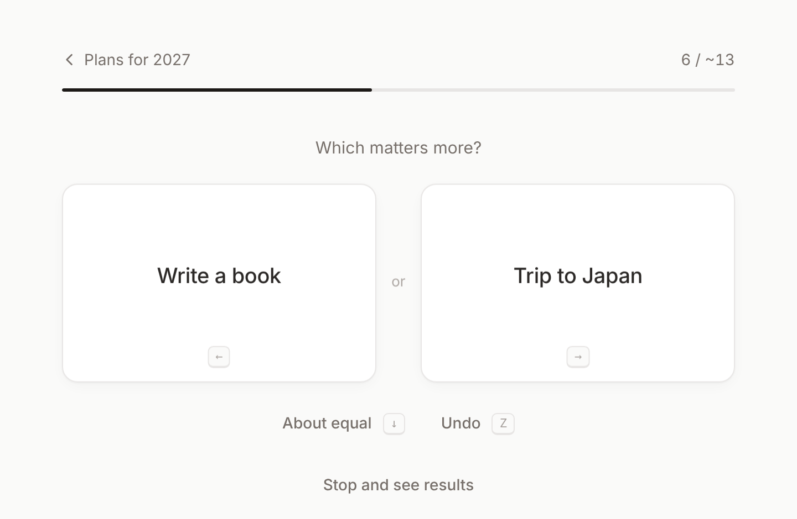
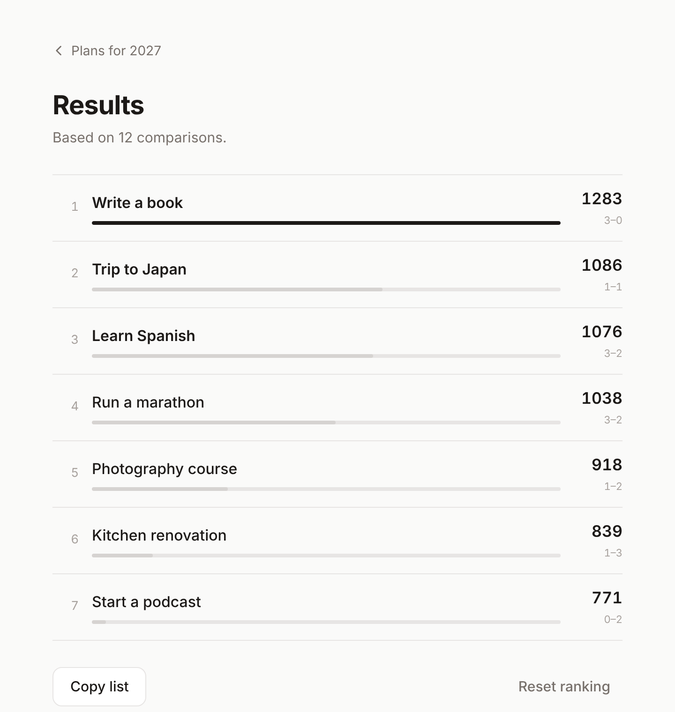

# Priorities

**Too many important things? Stop sorting them. Just choose — one pair at a time.**

[**→ Open the app**](https://marekbrze.github.io/decisions/) &nbsp;·&nbsp; [Download the file](https://raw.githubusercontent.com/marekbrze/decisions/main/index.html)

 

<picture>
  <source media="(prefers-color-scheme: dark)" srcset="docs/compare-dark.png">
  
</picture>

 

Ranking ten things from most to least important is exhausting. Answering *“this or that?”* takes a second.
**Priorities** asks you exactly that — and asks as few times as mathematically possible — then turns your answers into a scored ranking.

## Three steps

| | |
|:-:|---|
| **1** | **Write it all down.** Paste a whole list at once if you like. |
| **2** | **Pick from pairs** with `←` or `→`. A tie is `↓`, a mistake is `Z`. |
| **3** | **See the result** — an ordered list with a score for every item. |

<picture>
  <source media="(prefers-color-scheme: dark)" srcset="docs/results-dark.png">
  
</picture>

## Why you'll like it

- **Fast** — 7 items take about 13 choices, 20 items about 60. That's the theoretical minimum; nothing is ever asked twice.
- **Honest** — every decision is simple, and a quick double-check of neighbours catches answers you didn't mean.
- **Private** — no account, no server. Everything stays in your browser.
- **Come back anytime** — lists save themselves. Add something new and you'll only be asked about that.
- **One file** — download `index.html` and open it from your desktop, even offline.

<b>How does the ranking work?</b>

 

Three steps, all running quietly behind the cards:

1. **Binary insertion.** Each item is slotted into the already sorted list by asking *“above or below this one?”* — halving the options every time. If you said A > B and B > C, you'll never be asked about A and C.
2. **Double-check.** Every pair of neighbours gets one direct comparison. If an answer contradicts the order, the two swap places.
3. **Scores.** A [Bradley–Terry](https://en.wikipedia.org/wiki/Bradley%E2%80%93Terry_model) model — the maths behind chess Elo — turns all your answers into points on a familiar scale where 1000 is average. The gap between scores shows how clear-cut each choice was.

Add a new item later and you'll only be asked about that one (about log₂n questions).

<b>Backup and moving your data</b>

 

Data lives in the `localStorage` of the browser you use. The downloaded file and the online version don't see each other's lists — use **Export / Import** in the footer to move them (or to back them up).

 

No install · no account · no tracking · works on mobile and in dark mode

